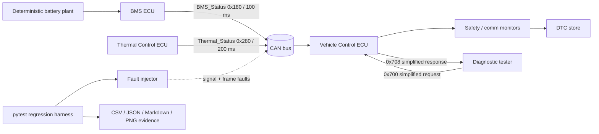

# Automotive CAN & ECU Test Automation Platform

A software-only automotive communication and regression-test platform built to demonstrate foundational CAN/DBC/ECU/diagnostics knowledge without pretending to be a production ECU or HIL system.

The repository models three virtual ECUs (Battery Management, Vehicle Control, Thermal Control), DBC-defined CAN traffic, application-level counter/checksum supervision, deterministic fault injection, a simplified UDS-like diagnostic server, automated Python/C++ tests, regression evidence, Linux SocketCAN integration, CI, and Docker reproducibility.

> **Portfolio scope:** this is a SIL-style educational/engineering test environment. It does **not** claim production ISO 14229/ISO-TP compliance, AUTOSAR E2E compliance, real-time determinism, transceiver/electrical validation, Vector CANoe equivalence, or HIL experience.

## What this project proves

- CAN frame and signal concepts: IDs, DLC, scaling, offset, signedness, endianness, cyclic transmission and arbitration context.
- DBC-defined message layouts with `cantools` for the real adapter and a dependency-free reference codec for deterministic tests.
- `python-can` + Linux SocketCAN/`vcan0` transport.
- ECU monitoring: SOC/voltage plausibility, over-temperature, rolling counter, application checksum, message timeout, DTC storage and recovery.
- Fault injection: dropped/delayed frames, invalid SOC, impossible temperature/voltage, stuck/noisy signals, counter corruption and checksum corruption.
- Educational diagnostics: session control, ReadDataByIdentifier, ReadDTCInformation, TesterPresent, ClearDiagnosticInformation, positive/negative responses.
- Automated unit, integration and regression testing with machine-readable/human-readable evidence.
- Meaningful embedded-flavoured C++ fault-monitor component built with CMake and tested with CTest.
- GitHub Actions, Docker, reproducible configs and documented engineering decisions.

## Architecture



The project exposes two CAN backends:

1. **In-memory deterministic SIL backend** — no kernel/hardware dependency, used for regression/CI and precise repeatability.
2. **SocketCAN backend** — `python-can` on Linux `vcan0` or another SocketCAN interface. DBC serialization can be handled by `cantools`.

## Repository layout

```text
automotive-can-test-platform/
├── .github/workflows/ci.yml
├── configs/
│   ├── regression.yaml
│   └── simulation.yaml
├── cpp/
│   ├── include/vehicle/fault_monitor.hpp
│   ├── src/fault_monitor.cpp
│   ├── src/fault_monitor_cli.cpp
│   └── tests/test_fault_monitor.cpp
├── dbc/vehicle_can.dbc
├── docs/
├── examples/
├── reports/example/
├── scripts/
│   ├── run_socketcan_demo.sh
│   ├── setup_vcan.sh
│   └── verify.sh
├── src/automotive_can/
│   ├── can/
│   ├── diagnostics/
│   ├── ecus/
│   ├── fault_injection/
│   ├── cli.py
│   ├── config.py
│   ├── dbc_codec.py
│   ├── model.py
│   ├── protection.py
│   ├── reporting.py
│   └── simulation.py
├── tests/
├── Dockerfile
├── Makefile
├── compose.yaml
└── pyproject.toml
```

## Message design

### `BMS_Status` — CAN ID `0x180`, 8 bytes, 100 ms

| Signal | Bits | Type | Scale/offset | Engineering intent |
|---|---:|---|---|---|
| SOC | 0..7 | uint8 | `0.5 %/bit` | battery state of charge |
| PackVoltage | 8..23 | uint16 LE | `0.1 V/bit` | pack voltage |
| PackCurrent | 24..39 | int16 LE | `0.1 A/bit` | signed pack current |
| MaxCellTemp | 40..47 | uint8 | `raw - 40 °C` | hottest cell temperature |
| BatteryState | 48..50 | uint3 | 1 | OFF/READY/CHARGING/FAULT |
| FaultFlags | 51..55 | uint5 | 1 | compact BMS fault flags |
| Counter | 56..59 | uint4 | 1 | modulo-16 rolling counter |
| AppChecksum | 60..63 | uint4 | 1 | educational nibble checksum |

The DBC deliberately permits SOC up to 127.5%. That is **not** a physical claim; it lets the test harness transmit `SOC=110%` so the receiving ECU can detect an implausible value. Serialization range and application plausibility range are intentionally separated.

### `Thermal_Status` — CAN ID `0x280`, 8 bytes, 200 ms

Contains coolant temperature, pump duty, fan duty, thermal state, counter and checksum. It demonstrates a second transmitting ECU on the network.

### Diagnostics — CAN IDs `0x700` / `0x708`

The repository uses a deliberately simplified single-frame diagnostic transport. Byte 0 is payload length and bytes 1..7 are diagnostic payload/padding. The service IDs and response conventions are UDS-inspired; the transport is **not ISO-TP**.

## Quick start

### Linux / WSL with normal Python environment

```bash
python3 -m venv .venv
source .venv/bin/activate
python -m pip install --upgrade pip
python -m pip install -e '.[dev]'

python -m automotive_can demo
pytest -q
make cpp
python -m automotive_can regression --output reports/latest
```

A one-command local verification is also provided:

```bash
./scripts/verify.sh
```

### SocketCAN / `vcan0`

Install Linux tools first:

```bash
sudo apt-get update
sudo apt-get install -y can-utils iproute2
./scripts/setup_vcan.sh
```

In one terminal:

```bash
candump vcan0
```

In another:

```bash
python -m automotive_can socketcan-demo --channel vcan0 --cycles 20 --period-ms 100
```

Expected traffic includes `0x180` BMS frames every ~100 ms. `python-can` handles the socket transport and `cantools` loads the DBC in this path.

> WSL note: `vcan` availability depends on the WSL kernel. If `ip link add ... type vcan` is unsupported, use a CAN-enabled WSL kernel, a Linux VM, or native Linux. The in-memory backend remains fully usable regardless.

## First end-to-end message

With:

```text
SOC          = 82.5 %
PackVoltage  = 400.2 V
PackCurrent  = -42.3 A
MaxCellTemp  = 31 °C
BatteryState = READY
FaultFlags   = 0
Counter      = 0
```

the signal bytes before the checksum nibble are derived as:

```text
SOC:          82.5 / 0.5 = 165      -> A5
Voltage:      400.2 / 0.1 = 4002    -> A2 0F (little-endian)
Current:      -42.3 / 0.1 = -423    -> 59 FE (signed little-endian)
Temperature:  31 + 40 = 71          -> 47
State/flags:                         -> 01
Counter:                             -> low nibble of byte 7
```

The high nibble of byte 7 is populated by the educational application checksum.

## Fault injection and expected behavior

Regression scenarios are declared in `configs/regression.yaml`, not hard-coded into tests.

| Fault | Injection layer | Expected receiver/test behavior |
|---|---|---|
| SOC > 100% | signal | plausibility warning + DTC |
| pack voltage too low | signal | plausibility warning + DTC |
| impossible temperature | signal | over-temperature warning + DTC |
| dropped messages | frame | communication timeout; counter jump may follow |
| delayed messages | frame | timeout and possible counter sequence errors |
| wrong counter | frame | counter error; checksum may also fail because protected data changed |
| checksum mismatch | frame | checksum warning + DTC |
| stuck SOC | signal | injected and verified by test harness; no generic ECU DTC by default to avoid false positives |
| noisy temperature | signal | deterministic bounded noise; no DTC while limits remain valid |

The stuck-signal design is intentional: a constant SOC can be physically valid over a short window. Production stuck-signal diagnostics require context, observability and calibration; this project injects/tests the condition but does not claim a universally correct stuck-SOC DTC.

## Vehicle ECU monitors

The `VehicleControlEcu` checks:

- SOC: `0..100 %`
- pack voltage: configured range (`250..450 V` by default)
- max cell temperature warning: `>60 °C`
- BMS cyclic timeout: `>300 ms`
- modulo-16 rolling counter progression
- educational application checksum
- configurable good-frame recovery count

Detected conditions are stored as 24-bit educational DTC codes and exposed to the diagnostic server.

## Diagnostics implemented

`EducationalUdsServer` supports:

| SID | Service | Implementation |
|---:|---|---|
| `0x10` | DiagnosticSessionControl | default `0x01`, extended `0x03` |
| `0x22` | ReadDataByIdentifier | configured DID callbacks |
| `0x19` | ReadDTCInformation | simple active-DTC list via subfunction `0x02` |
| `0x3E` | TesterPresent | basic positive response and counter |
| `0x14` | ClearDiagnosticInformation | simplified all-DTC clear |

Positive responses use `SID + 0x40`; negative responses use `0x7F, original SID, NRC`.

Not implemented: ISO-TP multi-frame transport, P2/P2* timing, SecurityAccess, programming, routines, authentication, OEM session/security state machines, complete NRC rules or ISO 14229 conformance.

## C++ component

`cpp/` contains a standalone `vehicle::FaultMonitor` using modern C++20 and no external test framework. It evaluates the same safety/communication concepts in a form closer to embedded application logic:

- SOC range
- voltage range
- temperature
- checksum validity
- rolling counter
- timeout supervision

Build and test:

```bash
cmake -S cpp -B cpp/build -DCMAKE_BUILD_TYPE=Release
cmake --build cpp/build --parallel
ctest --test-dir cpp/build --output-on-failure
```

A small `fault_monitor_cli` executable lets Python integration tests invoke the compiled component.

## Automated regression evidence

Run:

```bash
python -m automotive_can regression --output reports/latest
```

Generated artifacts include:

- `regression_summary.json` — machine-readable summary
- `regression_results.csv` — tabular result export
- `regression_report.md` — human-readable report
- `traces/*.csv` — time histories for every scenario
- `soc_trace.png` — invalid SOC injection vs plausibility limit
- `temperature_trace.png` — over-temperature injection vs threshold
- `fault_detection_summary.png` — scenario warning coverage

A verified example run is committed under `reports/example/`.

## Tests

The repository separates unit, integration and regression testing:

```text
tests/unit/         codecs, checksum/counter, ECU monitor, faults, UDS, virtual bus
tests/integration/  BMS -> CAN -> Vehicle, compiled C++ CLI, optional SocketCAN
tests/regression/   YAML-defined end-to-end fault scenarios
```

`pytest` automatically skips the external `cantools` parity check if `cantools` is unavailable and skips the real SocketCAN test unless `CAN_SOCKETCAN_TEST=1` is explicitly set with `vcan0` present.

## CI

GitHub Actions has three jobs:

- **Python**: install, Ruff lint, pytest + coverage, generate regression artifacts.
- **SocketCAN**: create `vcan0`, run a real `python-can` transmit/receive integration test.
- **C++**: CMake configure/build + CTest.

The CI config lives in `.github/workflows/ci.yml`.

## Docker

The default container runs the software-only demo and does not require host CAN capabilities:

```bash
docker build -t automotive-can-test-platform .
docker run --rm automotive-can-test-platform
```

For regression output mounted to the host:

```bash
docker compose run --rm can-platform
```

SocketCAN inside Docker is intentionally not the default because access to a host CAN interface and kernel modules is platform-specific and may require additional capabilities/network configuration.

## CAN concepts defended by this design

**Why CAN?** It is a robust, arbitration-based, multi-node broadcast bus suited to deterministic priority of relatively small control/status messages. Ethernet provides much greater bandwidth but has different cost, stack, topology and timing trade-offs; modern vehicles use both.

**What is a DBC?** A database describing how CAN payload bits map to engineering signals: start bit, length, byte order, signedness, scale, offset, min/max, units, messages and nodes.

**What is a CAN signal?** An engineering value encoded into one or more bits of a CAN frame. A frame may contain several signals.

**How are values encoded?** Typically `physical = raw * factor + offset`; signedness and byte order determine how raw bits are interpreted.

**What is arbitration?** CAN transmitters compare dominant/recessive bits while sending the identifier. A node transmitting recessive and observing dominant loses arbitration without corrupting the winning frame; lower numerical standard IDs therefore have higher priority.

**What is SIL?** Software-in-the-loop validates software behavior using simulated plant/environment and virtual communications without the target ECU hardware.

**What is HIL?** Hardware-in-the-loop connects real target/control hardware to real-time simulation and I/O interfaces so hardware timing, electrical I/O and integration can be tested.

**What is UDS?** Unified Diagnostic Services (ISO 14229) defines diagnostic application services such as sessions, DIDs, DTC operations, tester-present and programming/security services. This repository implements only a clearly labelled educational subset.

**What is a DTC?** A diagnostic trouble code representing a detected fault/condition with lifecycle/status behavior. This project uses simplified 24-bit educational codes, not OEM-specific diagnostic databases/status-byte semantics.

## Design decisions worth discussing in an interview

1. **Reference codec + cantools adapter:** deterministic tests do not depend on external packages/kernel CAN, while the real integration path still uses industry-standard Python tooling.
2. **DBC range differs from plausibility range:** the test system must be able to transmit invalid physical values to verify receiver checks.
3. **Counter/checksum kept intentionally simple:** the project demonstrates the concepts without falsely claiming AUTOSAR/OEM E2E implementation.
4. **Stuck signal is injected but not universally diagnosed:** absence of change alone is not proof of a sensor fault.
5. **Fault injection is deterministic:** regression failures are reproducible.
6. **C++ is functional, not decorative:** it implements executable supervision behavior and has its own tests.
7. **SIL and SocketCAN are separated from HIL claims:** the repository validates application/network behavior, not transceiver or target-hardware performance.

See `docs/design_decisions.md`, `docs/interview_guide.md` and `docs/limitations.md` for deeper notes.

## From virtual setup to real ECUs

A practical extension path is:

1. Replace `vcan0` with a SocketCAN-capable USB/CAN interface.
2. Preserve the DBC and test semantics.
3. Add real ECU power/wakeup/ignition control and timestamped capture.
4. Replace the educational diagnostic transport with ISO-TP + a standards-compliant UDS client/server stack.
5. Add OEM-specific E2E/counter/checksum rules and diagnostic databases.
6. Use CANoe/CANalyzer or another professional rest-bus/test environment where required.
7. Introduce real-time HIL hardware/plant models for target I/O, timing and fault insertion.

## Verified example results

The repository contains a generated example report from the included scenarios. In the build environment used to package this repository:

- Python core/unit/integration/regression tests: **39 passed**.
- External `cantools` parity test: **skipped locally** because the sandbox had no network access and `cantools` was not preinstalled.
- Optional SocketCAN test: **not executed locally** because the sandbox does not provide `python-can`/`vcan0`.
- C++: configured and compiled with CMake/G++ and **CTest passed**.
- Python integration test invoking the compiled C++ CLI: **passed**.
- Regression scenarios: **10/10 passed**, reports and PNG plots generated.

CI is configured to execute the external dependency and `vcan0` paths on GitHub-hosted Ubuntu where dependencies/kernel support are available.

## CV bullet — truthful after this implementation

> Developed a software-only CAN/ECU test automation platform with DBC-defined BMS/vehicle/thermal messages, Linux SocketCAN/python-can integration, cantools encoding/decoding, deterministic fault injection, automated regression tests, simplified UDS diagnostics, DTC/timeout/counter/checksum supervision, and a tested C++ fault-monitor component.

A shorter version:

> Built a virtual CAN-based ECU regression environment using SocketCAN, python-can, cantools, pytest and C++; validated BMS/vehicle communication under plausibility, timeout, counter, checksum and diagnostic fault scenarios.

## License

MIT. See `LICENSE`.
